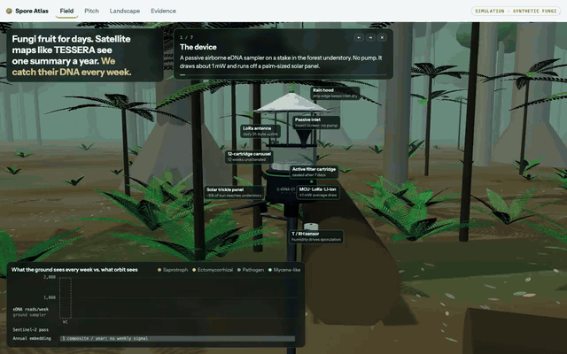
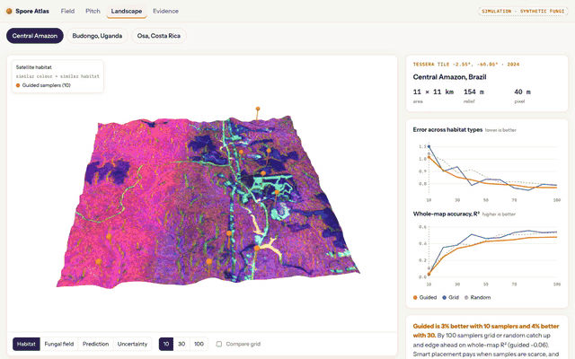
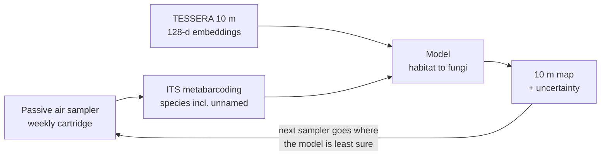

# Spore Atlas

**Mapping the hidden fungi of tropical forests at 10 m, with low-cost airborne eDNA samplers and free satellite embeddings.**

> Fungi are hidden helpers living under every forest. They feed trees, lock carbon into the soil, and gave us medicines like penicillin. But scientists have named fewer than 1 in 10 kinds, and rainforests, where most of them live, are the least explored places on Earth.
>
> Why is this so hard? Satellites can't see fungi; they only see the trees and land above them. Today's best fungi map is blurry: one dot covers a whole kilometre. And fungi pop up and vanish within days, while satellite maps update once a year.
>
> Our idea: put cheap boxes in the forest that catch fungal spores from the air every week. We read the spores' DNA to learn exactly which fungi were there, then match each catch to sharp 10-metre satellite pictures. A computer learns which places hold which fungi and tells us where the next box should go.
>
> **Next:** test it at 10 rainforest sites.

<table>
<tr>
<td width="50%"><br><sub><b>The sampler.</b> Rain triggers fruiting, wind carries spores into a sealed weekly cartridge. <a href="media/sampler.mp4">Full tour (MP4)</a></sub></td>
<td width="50%"><br><sub><b>The map.</b> Real Amazon habitat and terrain. Uncertainty drives where the next 10, 30, 100 samplers go. <a href="media/landscape.mp4">Full clip (MP4)</a></sub></td>
</tr>
</table>

**Run the demo:** open [`package/index.html`](package/index.html) in Chrome. One file, works offline. Presenter flow in [`package/README.md`](package/README.md).

*Spore Atlas is a working name. Fungal fields in the tropical demo are simulated; see [Evidence](#evidence).*

---

## Problem

| | |
|---|---|
| **Unknown** | ~155,000 fungal species described of an estimated 2 to 3 million: 5 to 8% [1]. In ectomycorrhizal fungi, 79 to 83% of soil DNA matches no named species [2]. |
| **Unsampled** | The wet tropics hold the most diversity and the fewest samples. Only 9.5% of mycorrhizal richness hotspots are protected [3]. |
| **Blurry** | The best global map predicts at 1 km [3]. One pixel spans 10,000 cells of 10 m. |
| **Too slow** | Satellite embeddings such as TESSERA summarise a year [4]. Fungi fruit and sporulate over days. |

## Gap

Habitat at 10 m is now free (TESSERA, AlphaEarth [4, 5]). Fungal labels are not. A 2026 preprint shows satellite embeddings predict ectomycorrhizal richness at 10 m from ~12,000 temperate and boreal soil samples [6]. No one has **dated, sequence-resolved, tropical** labels to do the same where it matters most.

## Approach



1. **Catch.** Passive samplers collect airborne spores into sealed 7-day cartridges, 12 weeks on solar. Passive capture overtook active samplers on total species after 48 to 96 h in a 2026 trial [7].
2. **Read.** Each sample is paired with a 10 m embedding of its landscape: TESSERA where covered, AlphaEarth everywhere, plus terrain and soil.
3. **Learn.** A model predicts fungi everywhere and reports its uncertainty.
4. **Choose.** Uncertainty-weighted k-means in embedding space places the next batch: informative, and covering every habitat type.

## Evidence

All numbers reproduce from the code in this repo.

### Real data: airborne fungal DNA at 47 sites

The Global Spore Sampling Project [9, 10] ran air samplers at 47 sites from 2018 to 2021: 1,630 to 2,400 dated samples, fungi identified by DNA to genus. 8 sites are tropical or subtropical, including Panama, Cameroon, Kenya and Madagascar. We pair each site with a 10 m satellite embedding of the 1 km around it (AlphaEarth [5], which covers every site; TESSERA [4] covers 17), SoilGrids soil [16] and Copernicus terrain. Leave-one-site-out ridge regression on log richness.

**When.** 79% of the variation in sample richness is within a site over time. Seasons explain 15%; **64% is week-to-week change** that any annual embedding, TESSERA or AlphaEarth, cannot see by construction. This is the gap weekly samplers fill.

**Where.**

| Predictors | R² | Sites |
|---|---|---|
| Latitude only | -0.04 | 37 |
| Latitude, terrain and soil (SoilGrids) | -0.10 | 37 |
| **AlphaEarth 10 m embedding** | **0.15** | 37 |
| Latitude, terrain, soil and AlphaEarth | 0.04 | 37 |
| **AlphaEarth 10 m embedding** | **0.15** | 47 |

| Head-to-head, same 17 sites | R² |
|---|---|
| Latitude and terrain | -0.23 |
| AlphaEarth (64-d) | -0.23 |
| TESSERA (128-d) | -0.24 |

**Reading:** the 10 m embedding is the only predictor that carries signal on airborne fungi; soil and latitude do not. The signal is modest and the head-to-head is inconclusive at 17 sites, mostly European. More sites, not better models, is the bottleneck. SPUN's 1 km map joins as a baseline when its GeoTIFFs are placed in `data/spun/` (available on request [17]).

### Simulation: real tropical habitat, synthetic fungi

Three 11 x 11 km TESSERA 2024 tiles with Copernicus GLO-30 terrain. A synthetic fungal field (habitat, elevation and a hidden spatial term) and 400 synthetic species with niche ranges from 0.04% to 5% of the landscape. Model: extremely randomised trees on 16 embedding components plus elevation; uncertainty is the spread across 200 trees. Guided vs the better of grid and random, mean of 5 runs.

| Landscape | Species found, 10 samplers | Rare species, 30 | Habitat-balanced error, 10 | Whole-map R², 100 |
|---|---|---|---|---|
| Central Amazon, Brazil | **159** vs 112 | **26** vs 21 | **1.02** vs 1.04 | 0.48 vs **0.54** |
| Budongo Forest, Uganda | **155** vs 127 | **26** vs 22 | **0.93** vs 0.94 | 0.49 vs **0.53** |
| Osa Peninsula, Costa Rica | **166** vs 134 | **27** vs 23 | **0.91** vs 0.97 | 0.35 vs **0.41** |

**Reading:** guided placement finds more species, more rare species and more habitat types when samplers are scarce, which is the tropical case. With 100 samplers an even grid maps the whole landscape better. Discovery and even coverage need different designs.

### Real data: 66 UK woodlands

Soil fungal diversity at 66 restored and ancient woodlands [8], TESSERA embeddings averaged over each site's 1 km cell, ridge regression, cross-validated R² (20 x 5-fold).

| Predictors | Fungal diversity (Shannon) | Functional groups (FUNGuild) |
|---|---|---|
| Soil and site (pH, conductivity, age, land use) | **0.21** | **0.08** |
| Satellite only | 0.08 | -0.01 |
| Soil, site and satellite | 0.03 | -0.06 |

**Reading:** satellite embeddings did not help here. 66 sites, coordinates rounded to 1 km, and soil pH dominating limit any 10 m signal. Precisely located, dated samples are what this test needs.

### Limitations

- The core claim, 10 m embeddings plus weekly air DNA beating the 1 km map in the tropics, is untested: 8 tropical sites is too few, and SPUN's map is not yet in the benchmark.
- Week-long passive sampling and cartridge storage in humid understory are untested.
- Guided placement helps most at small budgets; its edge shrinks as sampling grows.

## Research that informs this

| Finding | Source |
|---|---|
| 2 to 3 million fungal species, ~155,000 described | Current Biology review, 2025 [1] |
| Global mycorrhizal richness predictable at 1 km from ~25,000 soil samples; 9.5% of hotspots protected | Van Nuland et al., *Nature*, 2025 [3] |
| Satellite embeddings predict ectomycorrhizal richness at 10 m (temperate, soil) | SPUN, GlobalFungi, TESSERA, arXiv 2026 [6] |
| Airborne fungal DNA works at global scale; tropics richer than temperate; 6 of 47 sites in the Southern Hemisphere; our real-data benchmark uses its open data | Global Spore Sampling Project, *Nature* 2024, *Sci. Data* 2024 [9, 10] |
| Passive samplers beat active ones on total species after 48 to 96 h | Jager et al., 2026 [7] |
| 58 natural-product drugs launched 2014 to mid-2025 | Butler et al., *Nat. Prod. Rep.*, 2026 [11] |
| $708M median, $1.31B mean per approved drug; $2.23B including failures | RAND, 2025 [12]; Deloitte, 2025 [13] |

## Who pays

1. **Pharma and biotech:** a collection shortlist with location, habitat, consent and permit. Rare and unnamed taxa are the least-screened chemistry.
2. **Governments:** national fungal monitoring for Kunming-Montreal reporting.
3. **Farm biologicals:** matching microbial products to soils.
4. **eDNA and Earth-observation firms:** partners and data buyers.
5. **Insurance and lending:** later, once the map is proven.

**Moat:** a multi-year, weekly, DNA-identified record of airborne fungi at fixed tropical sites, each sample tied to its pixel and to signed consent under the Nagoya Protocol and Cali Fund. Satellite data, models and sampler hardware are open to everyone.

## Safeguards

- **Location secrecy:** rare species and chemistry hotspots are blurred or withheld.
- **No false absence:** uncertainty is always published.
- **Consent and benefit-sharing:** communities co-own data (CARE principles); data stays in-country.
- **Biosecurity:** handling and release rules for pathogen-bearing samples.
- **Footprint:** passive, no chemicals, every unit retrieved.

## Roadmap

| When | Milestone | Pass mark |
|---|---|---|
| 90 days | Benchmark on public labels vs SPUN 1 km and a climate-only model | Threshold fixed in advance; miss it and stop |
| 6 months | 10-site tropical pilot with open-source samplers, $15k to $45k | Measured cost per sample, cartridge survival |
| 12 months | One paying customer | Before any custom hardware |

## Reproduce

```bash
uv venv --python 3.13 .venv && uv pip install --python .venv/bin/python -r requirements.txt
export SSL_CERT_FILE=$(.venv/bin/python -m certifi)

# UK benchmark (needs the RestREco packs unzipped in data/raw/)
.venv/bin/python demo/uk_extract.py && .venv/bin/python demo/uk_model.py

# Real airborne DNA benchmark (GSSP archive from ipt.gbif.org/resource?r=tim-spores into data/gssp/,
# AlphaEarth index from storage.googleapis.com/alphaearth_foundations/.../aef_index.parquet into data/aef/)
cd demo && ../.venv/bin/python gssp_tessera.py && ../.venv/bin/python gssp_benchmark.py && cd ..

# Tropical simulation (downloads 3 TESSERA tiles, ~0.4 GB)
.venv/bin/python demo/tropics_sim.py

# Showcase and single-file package
cp demo/out/*.json showcase/public/data/
cd showcase && npm install && npm run package   # writes package/index.html
node record.mjs                                  # re-records media/
```

| Path | Contents |
|---|---|
| `demo/` | Real airborne DNA benchmark, UK benchmark, tropical simulation (Python) |
| `analytics/` | Team work: master table, demo frontend, data access report |
| `showcase/` | Vite + three.js app: Field, Pitch, Landscape, Evidence |
| `showcase/src/sampler/` | 3D passive airborne eDNA sampler and forest |
| `package/` | Single-file offline build and presenter notes |
| `media/` | Demo recordings |

## Data

- TESSERA v1.1 embeddings [4] and AlphaEarth Foundations annual embeddings [5] (CC-BY 4.0, produced by Google and Google DeepMind). Copernicus GLO-30 DEM. SoilGrids 2.0 [16].
- Global Spore Sampling Project airborne fungal DNA, CC-BY 4.0 [10].
- RestREco woodland datasets, NERC EDS Environmental Information Data Centre: soil metagenomics [8], insects, plants and trees [14], acoustic indices [15]. Unzip into `data/raw/<name>/`; not committed.

## References

1. [Fungal diversity estimates, *Current Biology*, 2025](https://pmc.ncbi.nlm.nih.gov/articles/PMC11687528)
2. [Dark taxa hotspots of ectomycorrhizal fungi, 2025](https://www.spun.earth/peer-reviewed-papers/mysterious-fungi-researchers-pinpoint-hotspots-of-dark-taxa-across-earths-underground-ecosystems)
3. [Van Nuland et al., *Nature*, 2025](https://www.nature.com/articles/s41586-025-09277-4)
4. [TESSERA](https://github.com/ucam-eo/tessera)
5. [AlphaEarth Foundations embeddings](https://developers.google.com/earth-engine/guides/aef_on_gcs_readme)
6. [Satellite embeddings and ectomycorrhizal richness at 10 m, arXiv:2604.09818, 2026](https://arxiv.org/abs/2604.09818)
7. [Jager et al., passive airborne eDNA sampling, 2026](https://repository.naturalis.nl/pub/801981/Jager-2026-A-Breath-of-Fresh-Air-A.pdf)
8. [Hibdige et al., soil metagenomics, EIDC, 2026](https://doi.org/10.5285/a21b8ed1-124b-4b2a-adb4-c3fdcc9f95a2)
9. [Global Spore Sampling Project, *Nature*, 2024](https://www.nature.com/articles/s41586-024-07658-9)
10. [Global Spore Sampling Project data, *Scientific Data*, 2024](https://www.nature.com/articles/s41597-024-03410-0)
11. [Butler et al., *Nat. Prod. Rep.*, 2026](https://pubs.rsc.org/en/content/articlelanding/2026/np/d5np00031a/unauth)
12. [RAND drug development costs, *JAMA Netw. Open*, 2025](https://www.news-medical.net/news/20250108/New-research-reframes-the-debate-on-drug-development-costs.aspx)
13. [Deloitte biopharma innovation, 2025](https://www.swissinfo.ch/eng/healthcare-innovation/why-drugs-are-becoming-more-expensive-to-develop/91851935)
14. [Waddell et al., insects, plants and trees, EIDC, 2025](https://doi.org/10.5285/8c997943-1f90-4897-87b3-491eaef534ec)
15. [Barnett et al., acoustic indices, EIDC, 2025](https://doi.org/10.5285/33b6dea2-94c5-4e33-a1b3-9a6bd1c8776a)
16. [SoilGrids 2.0, ISRIC](https://docs.isric.org/globaldata/soilgrids/)
17. [SPUN data request](https://www.spun.earth/data-request)
